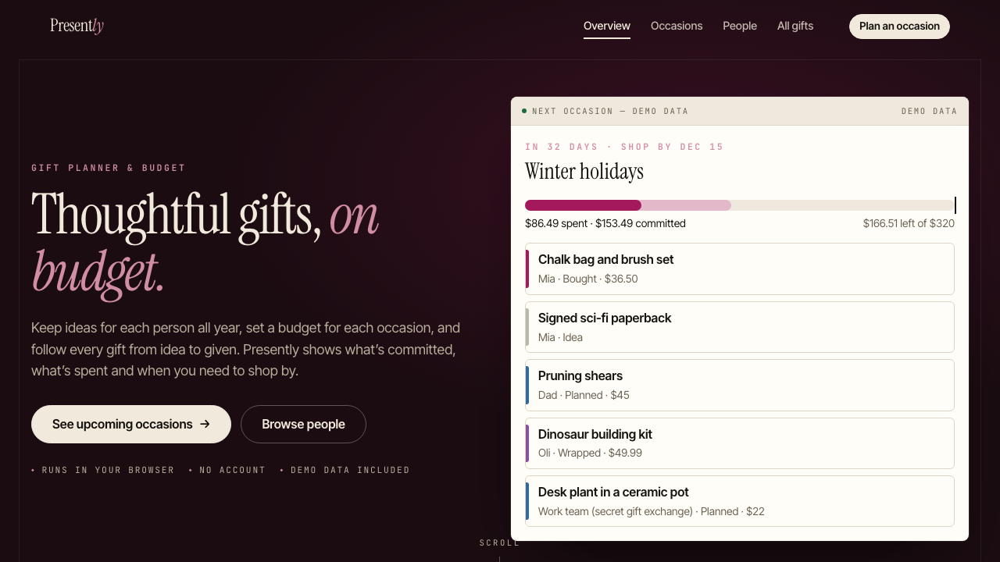
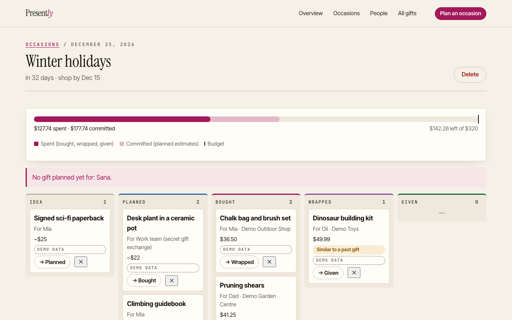
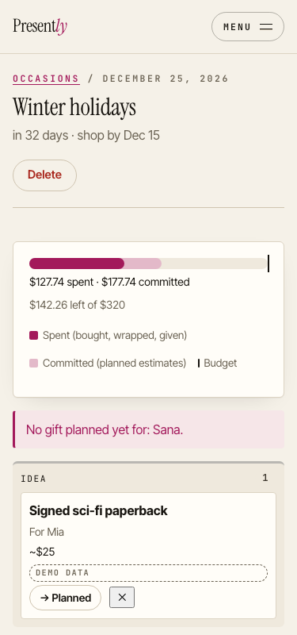

# Presently

A gift planner with budgets: people and what they like, occasions with countdowns and shop-by dates, gifts that move from idea to given, and a budget meter that separates what’s committed from what’s spent.

**Live demo:** [https://presently.vercel.app/](https://presently.vercel.app/) — runs entirely in your browser; demo data is fictional and labelled.



| Occasion board | Mobile |
| --- | --- |
|  |  |

## Run it

```bash
npm install
npm run dev        # http://localhost:5210
npm test
npm run build
npm run test:e2e   # Playwright smoke test (npm run e2e:install once if Chromium is missing)
```

## Main workflow

1. The app opens with labelled **demo data**: five people (one with a long name), three occasions (two yearly, one wedding) and gifts at every stage, including last year’s. **Occasions → Clear demo data** removes it.
2. **People** → name, relationship and likes/sizes. Each person’s page shows ideas and everything given before.
3. **Occasions** → countdown, date, shop-by date (date − delivery buffer) and a budget meter. Add one with a budget and “repeats every year”.
4. Open an occasion → a five-column board (idea, planned, bought, wrapped, given). Move gifts along; moving to *bought* asks what it cost. A notice lists people with nothing planned yet, and a table totals each person.
5. **All gifts** → quick-add an idea, search and filter by status, sort the table.

## Rules

- **Committed** = estimates of planned gifts + prices of bought/wrapped/given ones. **Spent** = only bought, wrapped and given. Ideas cost nothing until planned.
- Yearly occasions roll to next year once passed; 29 February falls on 28 February in other years. Gifts given before last year’s date belong to an earlier year and don’t count against this year’s budget.
- **Similar to a past gift** = a gift already given to the same person sharing a significant word (4+ letters).
- Shop-by dates in the past are highlighted.

## Design

Shared editorial system: Instrument Serif display type, Inter Tight interface text, a colour per stage carried through tags, board columns and badges, an ink hero whose preview is the real budget meter and gift list, and a warm paper workspace. Motion is disabled under `prefers-reduced-motion`.

## Tests

- `src/lib/gifts.test.ts` — next yearly date and leap days, shop-by dates, committed vs spent, occasion summary and overspending, yearly cycles, per-person totals, who’s missing, similar past gifts, status order, validation.
- `src/App.test.tsx` — occasion countdowns and meters, moving a gift, past-gift warning, occasion validation, quick idea and status filter.
- `e2e/smoke.spec.ts` — landing, move a gift to bought with a price, add a gift with reload persistence, person history, plus 375px layout checks.

## Limitations

- One browser only — not suitable for lists you must hide from people who share the device.
- No links, images or price tracking for gift ideas.
- One currency (US dollar formatting).

## Future improvements

- Shareable read-only wish lists; reminders exported to a calendar.

## Licence

MIT — see [LICENSE](LICENSE).
